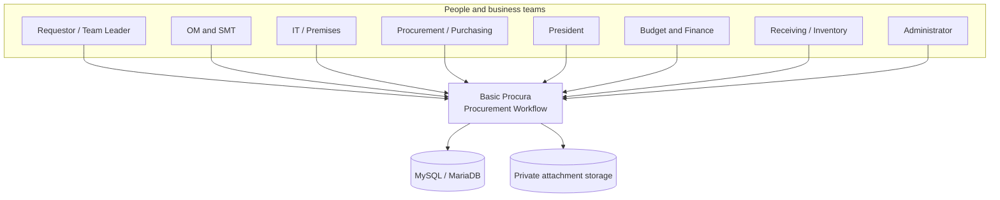
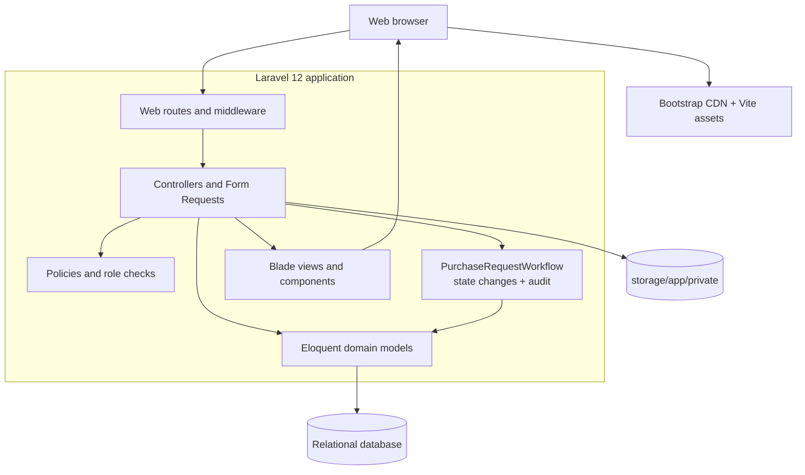
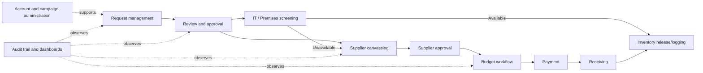
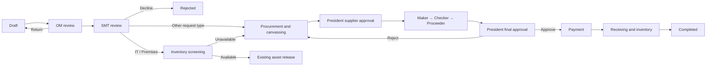
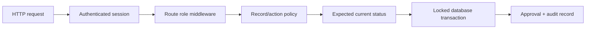
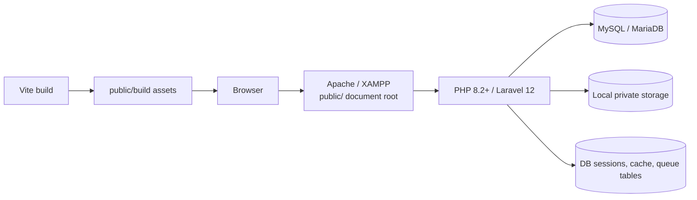

# High-Level Architecture

[Architecture index](README.md) · [Low-level architecture](LOW-LEVEL-ARCHITECTURE.md)

## 1. System purpose

Basic Procura is a role-based procurement and request-for-purchase workflow. It coordinates the people and records involved in:

1. Creating and submitting a purchase request.
2. OM and SMT review.
3. IT or Premises inventory screening when applicable.
4. Procurement canvassing and supplier selection.
5. Budget preparation, checking, and final approval.
6. Payment, receiving, and inventory recording.
7. Audit and operational reporting throughout the lifecycle.

The system is currently a **modular monolith**: presentation, application workflow, domain models, and persistence live in one Laravel application and deploy as one unit.

## 2. System context

There are no active third-party business integrations in the current codebase. Supplier quotation links may point to external URLs, but the application does not call supplier APIs. Mail, queues, cache, and notification storage are configured by Laravel, but the procurement flow is synchronous and does not currently define application jobs or notification dispatchers.

## 3. Major building blocks

| Building block | Responsibility |
| --- | --- |
| Routes and middleware | Define the web surface, require authentication, throttle login, and apply broad role gates |
| Controllers and Form Requests | Validate user input, authorize specific records, coordinate transactions, and select responses |
| Policies | Enforce record-level and action-level permissions |
| Workflow service | Validate legal status transitions, assign the next responsible role, create approval records, and write audit entries |
| Eloquent models | Represent procurement entities and their relationships |
| Blade UI | Render dashboards, request lists, forms, control-center screens, and admin screens on the server |
| Relational database | Store business records, sessions, cache, queue metadata, and audit history |
| Private file storage | Store request-item and screening attachments; downloads pass through authorization |

## 4. Business capability map

### Primary capabilities

- **Authentication:** session-based login/logout for active accounts.
- **Request management:** create drafts, update editable requests, submit, filter, paginate, and view details.
- **Workflow control:** role-specific queues and guarded state transitions.
- **Screening:** IT/manual inventory evidence or Premises CSV import, with asset recording.
- **Sourcing:** up to three supplier quotations, recommendation, supplier selection, and purchase-order generation.
- **Budget and finance:** maker, checker, proceeder, President final approval, and payment posting.
- **Receiving:** create a goods receipt and inventory record, then complete the request.
- **Administration:** manage user accounts, roles, active state, campaign assignments, and campaigns.
- **Traceability:** append audit records for workflow and administrative changes.

## 5. Users and responsibility boundaries

| User group | Main responsibility |
| --- | --- |
| Requestor / Team Leader | Own a request, maintain its draft/returned content, and submit it |
| OM/SMTS Approver | Perform the first formal review and return or advance the request |
| SMT | Approve and route by request type, or decline |
| IT Staff / Premises Staff | Determine whether requested assets are already available and record evidence/assets |
| Procurement Staff / Purchasing | Record quotations, manage sourcing, and create a purchase order |
| President | Select/approve a supplier and grant final budget approval |
| Budget Maker / Checker / Proceeder | Prepare, validate, and advance budget approval in sequence |
| Finance | Record payment after final approval |
| Inventory / Inventory Staff | Receive goods and create inventory records |
| Admin | Manage accounts/campaigns and bypass purchase-request policy checks |

`Purchasing` currently has temporary access to several downstream President, budget, payment, and receiving policy abilities for testing. This is an as-built exception, not a strict separation-of-duties design.

## 6. End-to-end lifecycle

This diagram presents the business flow at a readable level. The low-level document contains the exact status graph and implementation caveats.

Important business rules include:

- Every normal submission goes to OM first.
- Submitted requests require at least three line items; drafts may contain fewer.
- A requestor's campaign is derived from their account rather than trusted from form input.
- IT/Premises screening is one decision per request.
- Available screening requires asset details; unavailable screening routes to procurement.
- A request can contain no more than three quotations.
- Supplier approval precedes budget processing.
- Budget actions are sequential: Maker, Checker, Proceeder, then President.
- Payment is accepted only after President final approval.
- Receiving requires a purchase order and creates both receipt and inventory records.

## 7. Security and audit model

Security is layered:

- Login uses Laravel session authentication and is rate-limited to six attempts per minute.
- Inactive users cannot pass the custom role middleware or log in.
- Route middleware gives a coarse role gate; policies make the final action and record decision.
- State-changing workflow controllers use database transactions and `lockForUpdate()` to reduce duplicate/concurrent actions.
- The workflow service records old/new statuses, actor, remarks, IP address, and user agent.
- Attachments reside on the private disk and are streamed only after purchase-request authorization.
- Passwords are hidden and hashed by the `User` model; password-reset audit data does not contain the password.

## 8. Deployment view

### Current local/XAMPP shape

The `.env.example` defaults to MySQL with database-backed sessions, cache, and queue, and the local filesystem disk. The application can run behind XAMPP/Apache or Laravel's development server. Production should point the web root at `public/`, disable debug mode, use HTTPS, and run any configured queue worker separately.

## 9. Architectural characteristics

| Characteristic | Current approach |
| --- | --- |
| Consistency | Synchronous database transactions around multi-record workflow actions |
| Concurrency | Row locks on the purchase request or admin entity before mutable decisions |
| Traceability | Audit logs plus action-specific request approval records |
| Authorization | Session auth + role middleware + Laravel policies + status checks |
| Maintainability | Laravel conventions, thin domain service for transitions, Form Requests for complex forms |
| Scalability | Single application and relational database; suitable for internal operational load |
| Availability | Depends on the web process, database, and local filesystem being available |
| Extensibility | Additional workflow steps require coordinated enum, service, controller, UI, policy, and test changes |

## 10. Scope and current boundaries

The repository models more lifecycle states and tables than are exposed through complete controller actions. In particular, the declared state machine includes partial payment, delivery, partial receipt, inventory logging, endorsement, and fulfillment paths, while the current receiving controller implements a simplified `FOR_RECEIVING → COMPLETED` action. The low-level architecture identifies these differences so future work can distinguish existing behavior from planned domain breadth.
