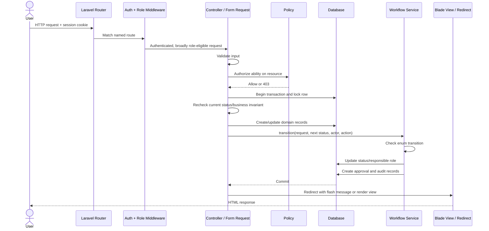
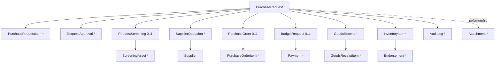
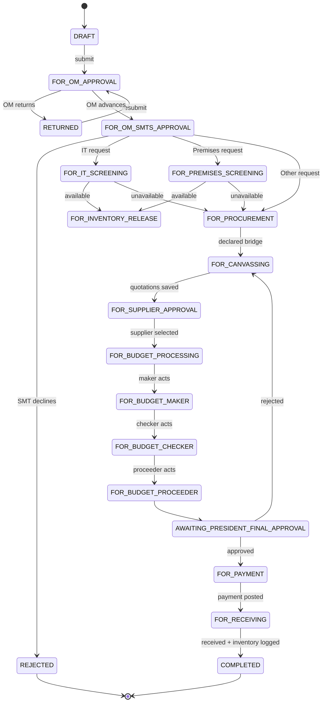
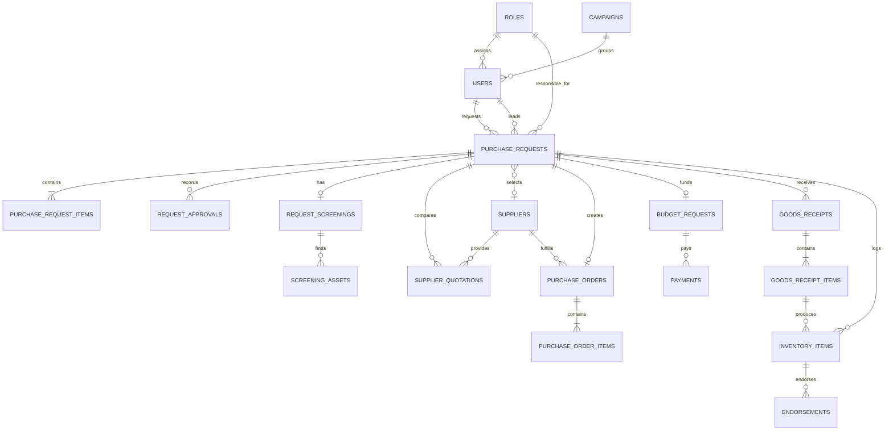
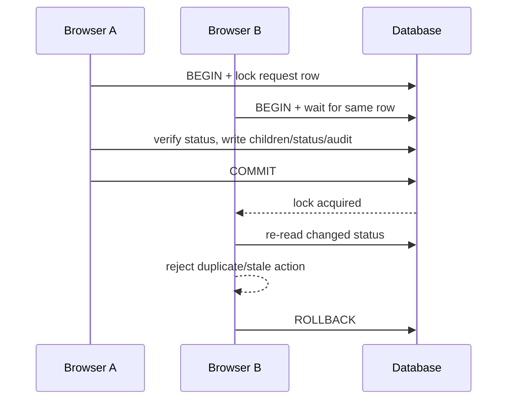

# Low-Level Architecture

[Architecture index](README.md) · [High-level architecture](HIGH-LEVEL-ARCHITECTURE.md)

## 1. Technology and runtime

| Area | Implementation |
| --- | --- |
| Backend | PHP 8.2+, Laravel 12 |
| Rendering | Server-rendered Blade templates |
| Styling | Bootstrap 5.3.8 from CDN plus project CSS; Tailwind 4 is available through Vite |
| Browser code | Small ES module bundle; Axios bootstrap and duplicate-form-submission guard |
| Asset build | Vite 7 with Laravel Vite plugin |
| Persistence | Eloquent ORM; MySQL/MariaDB in the supplied environment |
| Authentication | Laravel web guard, session cookies, database sessions by default |
| Files | Laravel `local` disk rooted at `storage/app/private` |
| Cache / queue | Database drivers by default; no domain jobs are currently defined |
| Tests | PHPUnit feature/unit tests and Node `.mjs` browser workflows |

## 2. Repository structure

```text
basic procura/
├── app/
│   ├── Enums/                 # Role and purchase-request status vocabulary
│   ├── Http/
│   │   ├── Controllers/       # Web use-case orchestration
│   │   ├── Middleware/        # Custom multi-role route gate
│   │   └── Requests/          # Reusable validation and authorization
│   ├── Models/                # Eloquent domain and supporting entities
│   ├── Policies/              # Ability and record authorization
│   ├── Providers/             # Application bootstrapping
│   └── Services/              # Central purchase-request workflow service
├── bootstrap/                 # Laravel bootstrap and middleware alias
├── config/                    # Auth, DB, filesystem, queue, session, etc.
├── database/
│   ├── factories/             # Test data factories
│   ├── migrations/            # Physical schema
│   └── seeders/               # Roles, users, campaigns, and demo workflow data
├── public/                    # HTTP entry point and public build output
├── resources/
│   ├── css/                   # Application design system and component styles
│   ├── js/                    # Browser bootstrap and submit guard
│   └── views/                 # Blade pages, layouts, partials, and components
├── routes/                    # Web and console route definitions
├── storage/                   # Private uploads, framework state, and logs
└── tests/                     # Unit, feature, and browser suites
```

## 3. HTTP request lifecycle



Read-only list and dashboard requests skip the transaction/workflow portion and build role-scoped Eloquent queries instead.

## 4. Route and controller map

All business routes are in `routes/web.php` and use the `web` middleware stack.

| Route area | Controller | Main operations | Route protection |
| --- | --- | --- | --- |
| `/login`, `/logout` | `Auth\LoginController` | Login form, authenticate active user, logout | Guest or authenticated session; login throttled |
| `/dashboard` | `DashboardController` | Role-specific KPIs and actionable queue | `auth` |
| `/request-flow` | `RequestFlowController` | Filterable workflow control center/history | `auth` |
| `/purchase-requests` | `PurchaseRequestController` | List, create, save draft, submit, show, edit, update | `auth` + policies inside controller/resource |
| `/attachments/{attachment}/download` | `AttachmentController` | Authorized private download | `auth` + purchase-request `view` policy |
| `/om-approvals/*` | `OmApprovalController` | Advance to SMT or return | OM/SMTS approver or admin + policy |
| `/smt-approvals/*` | `SmtApprovalController` | Route to screening/procurement or decline | SMT or admin + policy |
| `/request-flow/*/screening` | `ScreeningController` | IT/Premises availability decision and assets | IT/Premises/admin + policy |
| `/canvassing/*` | `CanvassingController` | Store quotations and select supplier | Procurement/Purchasing/admin route group; supplier selection uses President policy |
| `/purchase-orders/*` | `PurchaseOrderController` | Generate PO and PO items | Procurement/Purchasing/admin + policy |
| `/budget/*` | `BudgetController` | Maker, checker, and proceeder decisions | Budget/finance/purchasing/admin + policy |
| `/president-approvals/*` | `PresidentApprovalController` | Supplier and final budget decisions | President/purchasing/admin + policy |
| `/payments/*` | `PaymentController` | Record payment and advance to receiving | Finance/purchasing/admin + policy |
| `/receiving/*` | `ReceivingController` | Receipt, receipt item, inventory item, completion | Inventory/purchasing/admin + policy |
| `/admin/accounts/*` | `Admin\AccountController` | Account CRUD-without-delete and activation | Admin role |
| `/admin/campaigns/*` | `Admin\CampaignController` | Campaign CRUD-without-delete and activation | Admin role |

## 5. Purchase-request aggregate

`PurchaseRequest` is the aggregate root for the workflow. Controllers lock it before decisions, and most downstream records point back to it.



### Aggregate invariants enforced in code

- `request_number` is unique and generated as `REQ` plus a five-digit sequence, with a suffix fallback on collision.
- New requests start as `DRAFT` and receive a `CREATED_DRAFT` audit entry.
- The request total is recalculated from its item quantities and estimated unit prices.
- Submitting requires a valid campaign-derived owner context and at least three request items.
- Only draft/returned requests can normally be edited by their owner; OM may edit during OM review.
- State-changing actions re-read the request using a row lock and verify the expected status.
- Deleting a purchase request is not exposed and the policy always denies it.

## 6. State machine

### Primary business path and required state bridges



The diagram combines controller actions with enum-declared bridge states so the intended business sequence remains visible. The `FOR_PROCUREMENT → FOR_CANVASSING` bridge and the `FOR_BUDGET_PROCEEDER → AWAITING_PRESIDENT_FINAL_APPROVAL` bridge have no dedicated controller actions. The current Proceeder controller tries to skip the latter bridge and is rejected by the enum. These gaps are detailed in section 16.

The status names for budget steps represent the status **after** the named actor has acted. For example, the Maker action changes `FOR_BUDGET_PROCESSING` to `FOR_BUDGET_MAKER`; the Checker endpoint then expects `FOR_BUDGET_MAKER`. This can be counterintuitive when reading queues.

Implementation note: the current enum also permits the live `FOR_BUDGET_CHECKER → AWAITING_PRESIDENT_FINAL_APPROVAL` Proceeder action, and Purchasing can submit directly from `FOR_PROCUREMENT` to `FOR_SUPPLIER_APPROVAL` after recording exactly one supplier recommendation.

### Additional declared states

The enum also declares older or future-granularity paths: `FOR_TL_APPROVAL`, `SUPPLIER_APPROVED`, `APPROVED`, `PO_CREATED`, `PAYMENT_PENDING`, `PARTIALLY_PAID`, `FOR_DELIVERY`, `PARTIALLY_RECEIVED`, `RECEIVED_WITH_INVOICE`, `FULLY_PAID`, `FOR_INVENTORY_LOGGING`, `ENDORSED`, `FULFILLED`, and `CANCELLED`. Most have no dedicated action endpoint in the current route file.

### Transition side effects

`PurchaseRequestWorkflow::transition()` performs four coordinated operations:

1. Confirms the transition exists in `PurchaseRequestStatus::allowedTransitions()`.
2. Updates `purchase_requests.status`, `current_responsible_role_id`, and first submission time.
3. Creates a `request_approvals` record when an approval level is supplied.
4. Creates a polymorphic `audit_logs` record with actor and request metadata.

Responsibility is assigned by status to the requestor's role, OM/SMTS, SMT, IT, Premises, Procurement, President, budget roles, Finance, or Inventory. Terminal and unassigned statuses clear the responsible role.

## 7. Detailed workflow actions

| Action | Preconditions | Records written | Next status |
| --- | --- | --- | --- |
| Save request | `create`/`update` policy; valid fields | Request, items, optional private item attachments, audit | `DRAFT` unless submitted |
| Submit | Owner/admin; `DRAFT` or `RETURNED`; minimum three items | Request status, audit | `FOR_OM_APPROVAL` |
| OM advance | OM policy; `FOR_OM_APPROVAL` | Approval, audit | `FOR_OM_SMTS_APPROVAL` |
| OM return | OM policy; remarks required | Approval, audit | `RETURNED` |
| SMT approve | SMT policy; `FOR_OM_SMTS_APPROVAL` | Approval, audit | IT/Premises screening or procurement by request type |
| Screening | Matching team; one screening only | Screening, assets when available, attachments, approval, audit | Inventory release or procurement |
| Store quotations | Canvassing policy; maximum three total | Suppliers, quotations, approval, audit | Intended `FOR_SUPPLIER_APPROVAL` |
| Select supplier | President policy; quote must belong to request | Selected supplier, quote approval fields, approval, audit | `FOR_BUDGET_PROCESSING` |
| Create PO | Canvassing policy; selected quoted supplier; budget-processing status | PO, PO items, audit | No status change |
| Budget Maker | Budget policy; `FOR_BUDGET_PROCESSING` | Budget request, approval, audit | `FOR_BUDGET_MAKER` |
| Budget Checker | Budget policy; `FOR_BUDGET_MAKER` | Budget request, approval, audit | `FOR_BUDGET_CHECKER` |
| Budget Proceeder | Budget policy; `FOR_BUDGET_CHECKER` | Transaction is rolled back under current rules | Controller attempts `AWAITING_PRESIDENT_FINAL_APPROVAL`, but the enum requires `FOR_BUDGET_PROCEEDER` first |
| President final | President policy; awaiting final approval | Budget approval fields, approval, audit | Payment or canvassing |
| Payment | Finance policy; `FOR_PAYMENT` | Payment, budget release fields, approval, audit | `FOR_RECEIVING` |
| Receiving | Inventory policy; PO required | Receipt, receipt item, inventory item, approval, audit | `COMPLETED` |

## 8. Authorization design

### Layer 1: authentication

All application routes except login require the `auth` middleware. `LoginRequest` authenticates credentials, rejects inactive users, and regenerates the session. Logout invalidates and regenerates the CSRF token.

### Layer 2: route role gate

`EnsureUserHasRole` accepts one or more role slugs and requires both an active account and a matching role. It is registered as the `role` alias in `bootstrap/app.php`.

### Layer 3: policies

`PurchaseRequestPolicy` handles visibility, ownership, editing, submission, and each workflow ability. Admin is allowed before other checks. Visibility is broader for workflow roles than action authorization, allowing relevant teams to inspect requests while controllers still enforce action-specific abilities and statuses.

`UserPolicy` and `CampaignPolicy` grant Admin a global before-check. `AuditLogPolicy` makes audit viewing Admin-only. Admin routes also have an explicit role middleware gate.

### Layer 4: state and data invariants

Controllers check the current status and related records after acquiring a row lock. The workflow service independently validates the requested state edge. This prevents a valid role from performing an action at the wrong stage.

## 9. Data model

### Core entity relationship diagram



### Table catalog

| Group | Tables | Purpose |
| --- | --- | --- |
| Identity | `roles`, `users`, `campaigns` | One role and optional campaign per user; active-state administration |
| Request | `purchase_requests`, `purchase_request_items`, `request_approvals` | Aggregate root, requested lines, and action history |
| Screening | `request_screenings`, `screening_assets` | One team decision per request and available-asset details |
| Sourcing | `suppliers`, `supplier_quotations` | Supplier directory, quote comparison, recommendation and approval |
| Ordering/budget | `purchase_orders`, `purchase_order_items`, `budget_requests`, `payments` | Commercial order, budget approval chain, and payment history |
| Fulfillment | `goods_receipts`, `goods_receipt_items`, `inventory_items`, `endorsements` | Receiving, inventory creation, and final handoff |
| Cross-cutting | `attachments`, `audit_logs`, `notifications` | Polymorphic files, polymorphic audit history, Laravel notifications |
| Framework | `sessions`, `cache`, `cache_locks`, `jobs`, `job_batches`, `failed_jobs`, `password_reset_tokens` | Runtime infrastructure |

### Relationship notes

- Attachments are polymorphic and currently attach to request items or request screenings; the model also permits direct request attachments.
- Audit logs are polymorphic and are used for purchase requests, users, and campaigns.
- Soft deletes exist on requests, request items, suppliers, quotations, purchase orders, budget requests, payments, goods receipts, inventory items, endorsements, attachments, and campaigns, although destructive UI routes are intentionally absent.
- Foreign-key delete behavior is deliberately mixed: important historical actors commonly use `restrictOnDelete` or `nullOnDelete`, while aggregate children often cascade.

## 10. Validation and input handling

Reusable Form Requests cover login, account/campaign create/update, purchase-request create/update, OM/SMT decisions, and screening decisions. Simpler downstream actions validate inline in their controllers.

Notable validation rules:

- Request type and item shapes are allow-listed; totals are computed server-side.
- Request submission is distinguished from saving a draft using the submitted action.
- Supplier quotes allow one to three inputs per call and no more than three stored per request.
- Screening assets allow up to 100 entries and restrict their source according to IT or Premises team.
- Premises CSV files require normalized columns: `asset_tag`, `item_code`, `description`, `serial_number`, `location`, `release_date`, and `recipient`.
- Password confirmation, role/campaign compatibility, unique emails, and last-active-admin protection are enforced in admin workflows.

## 11. Transactions and concurrency

Workflow decisions and admin mutations run inside `DB::transaction()`. After route-model binding, controllers query the entity again with `lockForUpdate()` so that the decision is made against a locked, fresh database row.



This pattern protects duplicate OM/SMT decisions, repeated screening, supplier/budget actions, payment, receiving, and critical admin changes. Browser JavaScript also disables duplicate form submission, but database locking is the authoritative protection.

## 12. Files and attachments

1. Request-item files are stored under `purchase-requests/{request-id}/items` on the local disk.
2. Screening evidence and Premises CSV imports are stored under `purchase-requests/{request-id}/screening`.
3. Metadata is stored in `attachments`, including uploader, category, original name, disk, path, MIME type, and size.
4. The local disk resolves to `storage/app/private` and is not directly public.
5. `AttachmentController` resolves the parent request, checks its `view` policy, confirms the file exists, and streams the download.

## 13. Presentation layer

Blade provides a shared authenticated layout, error layout, page views, partial forms, and reusable components for icons, page headers, empty states, and status badges. Navigation is computed from the authenticated user's role and links directly to their relevant queue/filter.

The UI uses:

- Bootstrap 5.3.8 layout/components loaded from a CDN.
- Project CSS variables and component styles for ASI Procura branding.
- Vite for `resources/css/app.css` and `resources/js/app.js`.
- Minimal JavaScript; business rules remain server-side.
- Server redirects and session flash messages after mutations.

## 14. Query/read architecture

`DashboardController`, `RequestFlowController`, and `PurchaseRequestController::index()` act as read-model builders. They scope queries by owner, campaign, role, current responsible role, and stage/status before calculating counts or paginating results. This prevents summary counts from revealing requests that are not in the user's visible set.

The dashboard additionally maps each actionable status to a policy ability and target screen. The request-flow page accepts named summary/stage filters rather than exposing unrestricted arbitrary query construction.

## 15. Testing architecture

| Layer | Coverage |
| --- | --- |
| Unit | Allowed initial/terminal state transitions |
| Feature | Authentication, dashboards, account/campaign management, request list scoping, validation, workflow permissions, concurrency/duplicates, screening, auditing, attachments, and PO generation |
| Browser | Authentication, dashboard smoke checks, request flow, purchase-request module, procurement E2E, account management, and campaign/password workflows |

Typical verification commands are:

```powershell
& 'C:\xampp\php\php.exe' artisan test
& 'C:\xampp\php\php.exe' vendor\bin\pint --test
npm run build
```

Browser `.mjs` workflows require a running application and their configured browser automation environment; they are not part of the default PHPUnit command.

## 16. As-built observations and gaps

These are documentation findings, not changes made to application behavior:

1. **Procurement-to-canvassing bridge:** the enum only allows `FOR_PROCUREMENT → FOR_CANVASSING`, but no route/controller performs that transition. `CanvassingController::storeQuotations()` accepts `FOR_PROCUREMENT` and attempts to transition directly to `FOR_SUPPLIER_APPROVAL`, which the enum rejects. The quotation happy path is executable only when the request is already `FOR_CANVASSING` or the transition rules/action are aligned.
2. **Budget Proceeder transition:** the controller calls `FOR_BUDGET_CHECKER → AWAITING_PRESIDENT_FINAL_APPROVAL`, while the enum currently allows only `FOR_BUDGET_CHECKER → FOR_BUDGET_PROCEEDER`. This action will fail until the controller or enum sequence is aligned.
3. **PO lifecycle:** PO creation writes the order and audit record but intentionally does not change the purchase-request status. Declared `APPROVED` and `PO_CREATED` statuses are not used by this controller path.
4. **Two supplier-decision APIs:** `CanvassingController::approveSupplier()` selects and marks a quotation before budget processing. `PresidentApprovalController::supplierDecision()` also advances/rejects the supplier stage, but its approval branch does not select a supplier. UI and future API consumers should use one canonical path.
5. **Simplified fulfillment:** screening-available requests stop at `FOR_INVENTORY_RELEASE` because no release/logging/endorsement endpoint is defined. Purchased requests use the simpler payment → receiving → completed path, leaving several detailed enum states unused.
6. **Notifications and queues:** schema/configuration exist, but no application notification dispatch or queued domain job is present.
7. **Temporary expanded Purchasing access:** policies explicitly grant Purchasing several downstream abilities for testing. Remove these grants when strict production segregation of duties is required.
8. **README styling description:** the project README calls out Bootstrap, which is accurate for runtime rendering; Tailwind is installed in the asset toolchain but the current views primarily use Bootstrap/project CSS.

### Current workflow correction (2026-09-01)

The first two historical observations above have been resolved in the current implementation: `FOR_PROCUREMENT → FOR_SUPPLIER_APPROVAL` is now allowed for Purchasing's recommendation handoff, and the live Budget Proceeder controller transition to final President approval is legal. `PresidentApprovalController::supplierDecision()` is now the canonical supplier approval path; the legacy Canvassing approval endpoint is blocked for Purchasing.

## 17. Safe change guide

### Adding or changing a workflow stage

Update all of the following together:

1. `PurchaseRequestStatus` enum and allowed transitions.
2. `PurchaseRequestWorkflow::responsibleRoleId()`.
3. Role enum/seeder if a new actor is involved.
4. Route middleware and `PurchaseRequestPolicy` ability.
5. Controller transaction, row lock, expected-status check, and transition call.
6. Request validation and Blade action UI.
7. Dashboard/request-flow status groups and labels.
8. Unit, feature, and browser tests.
9. Both architecture documents if the business flow changes.

### Adding a new entity

Create a migration, model relationships/casts/fillable fields, authorization policy if exposed, transactional controller/service logic, database indexes for common filters, factories/seed data as appropriate, and feature tests. Decide explicitly whether deletion should cascade, restrict, null, or soft-delete.

### Adding an external integration

Keep credentials in environment-backed configuration, isolate the provider behind an application service, use queued jobs for retryable I/O, dispatch only after the database commit when the external call depends on committed state, record correlation/status data, and make retries idempotent.

## 18. Key source files

| Concern | Source |
| --- | --- |
| Web surface | `routes/web.php` |
| Application bootstrapping | `bootstrap/app.php` |
| Status graph | `app/Enums/PurchaseRequestStatus.php` |
| Role vocabulary | `app/Enums/RoleSlug.php` |
| Transition/audit behavior | `app/Services/PurchaseRequestWorkflow.php` |
| Aggregate model | `app/Models/PurchaseRequest.php` |
| Main authorization | `app/Policies/PurchaseRequestPolicy.php` |
| Request CRUD/submission | `app/Http/Controllers/PurchaseRequestController.php` |
| Downstream actions | `app/Http/Controllers/*ApprovalController.php`, `ScreeningController.php`, `CanvassingController.php`, `BudgetController.php`, `PaymentController.php`, `ReceivingController.php` |
| Physical data model | `database/migrations/` |
| Presentation | `resources/views/`, `resources/css/app.css`, `resources/js/app.js` |
| Behavioral specification | `tests/` |
