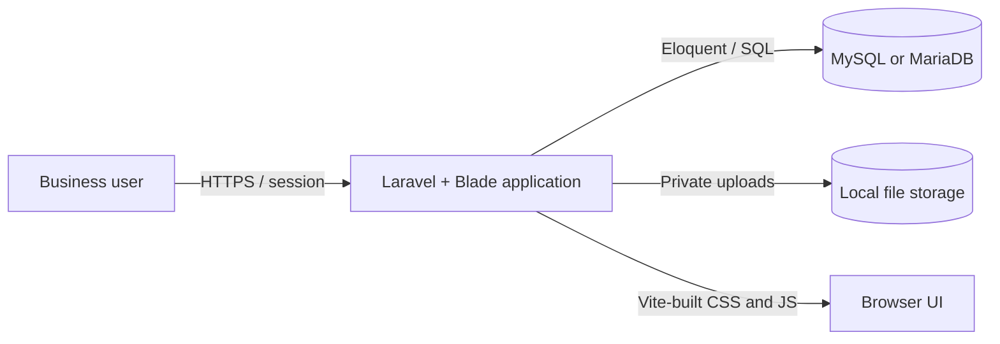

# Basic Procura Architecture

This folder documents the **as-built architecture** of Basic Procura. It is based on the application code, routes, migrations, policies, views, configuration, and tests in this repository.

## Choose your view

| Document | Best for | What it explains |
| --- | --- | --- |
| [High-Level Architecture](HIGH-LEVEL-ARCHITECTURE.md) | Product owners, new team members, reviewers, and architects | System purpose, users, major building blocks, business flow, deployment, and architectural qualities |
| [Low-Level Architecture](LOW-LEVEL-ARCHITECTURE.md) | Developers, testers, maintainers, and database administrators | Routes, controllers, state transitions, authorization, transactions, models, tables, files, UI, and tests |

## One-minute summary

Basic Procura is a server-rendered Laravel 12 application for managing procurement requests. A purchase request is the aggregate at the center of the system. Authenticated users act on it according to their role, while `PurchaseRequestWorkflow` validates state changes and writes an audit trail.

## Documentation conventions

- **As-built** means behavior that exists in the current repository.
- **Declared state machine** means transitions allowed by `PurchaseRequestStatus`.
- **Implemented action** means a route and controller currently perform the operation.
- Dashed arrows in diagrams represent conditional, alternate, or not-fully-wired paths.
- Status names are shown in code form, such as `FOR_OM_APPROVAL`, when precision matters.

## Source of truth

When documentation and code disagree, use these sources in this order:

1. `app/Enums/PurchaseRequestStatus.php` for allowed state transitions.
2. `app/Services/PurchaseRequestWorkflow.php` for transition side effects and responsibility assignment.
3. `routes/web.php` and the relevant controller for exposed behavior.
4. Policies and role middleware for authorization.
5. Migrations for the physical database schema.
6. Models for Eloquent relationships and casts.

Last reviewed against the repository: **2026-09-01**.
