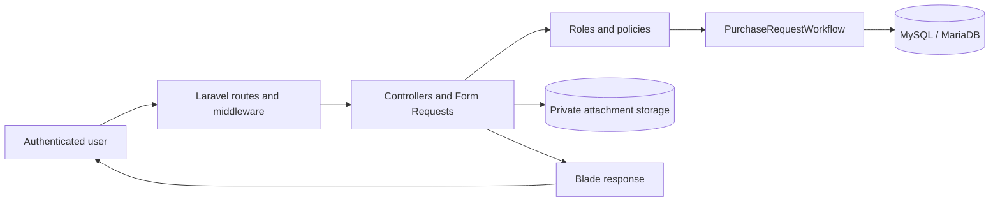
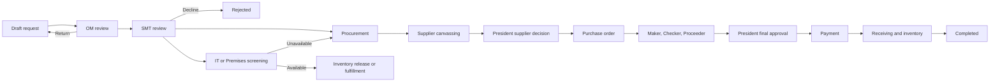

# ASI Procura System Documentation

Document type: Technical and functional overview  
Application name: ASI Procura  
Repository name: Basic Procura  
Framework: Laravel 12  
Last reviewed: September 7, 2026

## 1. Project Summary

ASI Procura is an internal, role-based procurement and request-for-purchase system. It provides a single workflow for preparing purchase requests, obtaining management approval, checking available assets, canvassing suppliers, preparing purchase orders and budgets, recording payment, receiving goods, and updating inventory.

The application is implemented as a Laravel modular monolith. Its user interface, workflow rules, authorization policies, application services, and database access are deployed together as one web application. MySQL or MariaDB stores the business records, while uploaded supporting documents are kept in private application storage.

### 1.1 Project Objectives

ASI Procura is intended to:

- Standardize the purchase-request process from draft through completion.
- Route each request to the correct user or department based on its current workflow stage.
- Enforce role-based access to requests, approvals, screening, purchasing, finance, and inventory functions.
- Provide visibility into pending requests and actions through role-specific dashboards and queues.
- Maintain traceable approval, status, and administrative histories.
- Store supplier quotations, purchase orders, budget information, payment references, receipts, and inventory records in one system.
- Reduce duplicate submissions and inconsistent workflow decisions through validation, database transactions, and record locking.

## 2. Architecture

ASI Procura uses a server-rendered, layered Laravel architecture.

- **Presentation layer:** Blade templates, Bootstrap, project CSS, and small JavaScript enhancements.
- **Request layer:** Laravel web routes, authentication middleware, role middleware, controllers, and Form Requests.
- **Authorization layer:** Laravel policies and record-level checks.
- **Application layer:** `PurchaseRequestWorkflow` validates state transitions, assigns responsibility, and creates audit records.
- **Domain and persistence layer:** Eloquent models backed by MySQL or MariaDB.
- **File layer:** Laravel's private local disk for request and screening attachments.

**High-level flow:**



**Primary procurement flow:**



The state enumeration contains additional statuses for partial payment, delivery, partial receipt, inventory logging, and endorsement. Some of those detailed paths are declared for future or legacy use but do not yet have complete route and controller coverage.

## 3. Tech Stack

| Area | Technology |
| --- | --- |
| Backend language | PHP 8.2 or newer |
| Application framework | Laravel 12 |
| Rendering | Laravel Blade templates |
| User interface | HTML5, Bootstrap 5.3.8, and project CSS |
| Browser scripting | JavaScript ES modules and Axios |
| Asset pipeline | Vite 7 with the Laravel Vite plugin |
| Additional styling tooling | Tailwind CSS 4 plugin is available in the build configuration |
| Database | MySQL 8+ or MariaDB 10.3+ |
| ORM | Laravel Eloquent |
| Authentication | Laravel session-based web authentication |
| Session, cache, and queue drivers | Database by default |
| Attachment storage | Laravel local private filesystem |
| Backend testing | PHPUnit 11 through Laravel's testing framework |
| Browser testing | Node.js `.mjs` workflow scripts |
| Local runtime | XAMPP/Apache or Laravel's development server |

### 3.1 Features

- Server-rendered responsive user interface.
- Role-specific navigation, dashboard statistics, and action queues.
- Filterable and paginated purchase-request lists.
- Central workflow state-transition service.
- Policy-based record and action authorization.
- Form Request and controller-level server validation.
- Database transactions and row locking for mutable workflow decisions.
- Private attachment storage with authorized downloads.
- Audit records containing the actor, action, status change, remarks, IP address, user agent, and supporting metadata.
- Soft deletion for applicable business entities while preserving historical records.
- Duplicate-form-submission protection in the browser and duplicate-action protection on the server.

### 3.2 Authentication & Access Control

**Description:**  
ASI Procura uses email-and-password authentication backed by Laravel sessions. Only active accounts can log in. Successful login regenerates the session identifier, logout invalidates the session, and login attempts are limited to six attempts per minute. Passwords are hashed and hidden by the User model.

Protected routes require an authenticated session. Workflow route groups apply broad role middleware, while Laravel policies perform action-level and record-level authorization. Requestors can access their own requests; workflow participants receive access according to their roles, assignments, and applicable workflow actions. Administrators manage accounts, roles, campaign assignments, and account status.

**User Impact:**

- Users see navigation and queues relevant to their assigned roles.
- Inactive users cannot start a new authenticated session.
- Unauthorized actions return an access-denied response.
- Requestors cannot edit another requestor's records.
- Screening actions require the correct IT or Premises assignment.
- Administrative functions are restricted to the Admin role.

### 3.3 User & Employee Management

**Description:**  
Administrators can create accounts, assign one system role, assign a campaign when required, update account details, reset passwords, and activate or deactivate accounts. Requestor and Team Leader accounts require an active campaign assignment. Account creation, role changes, campaign changes, password resets, and status changes are recorded in the audit history. The last active administrator cannot be deactivated or demoted.

The operational owner for provisioning and deactivation is the Team Leader together with the Developer. Account creation, transfer, role-change, and deactivation requests should be communicated and completed through their approved internal process.

**User Impact:**

- Each user receives access based on a defined role.
- Requestors and Team Leaders work within their assigned campaign.
- Disabled accounts cannot log in again.
- Existing procurement records are preserved when an account changes role or status.
- Administrative changes remain traceable through audit records.

## 4. Repository Structure

```text
basic procura/
|-- app/
|   |-- Enums/                 # Role and workflow status definitions
|   |-- Http/
|   |   |-- Controllers/       # Web request and business-action handlers
|   |   |-- Middleware/        # Custom role middleware
|   |   `-- Requests/          # Input validation and authorization
|   |-- Models/                # Eloquent business models
|   |-- Policies/              # Record and action authorization
|   |-- Providers/             # Application service providers
|   `-- Services/              # Central procurement workflow service
|-- ARCHITECTURE/              # High-level and low-level architecture documents
|-- bootstrap/                 # Laravel application bootstrap
|-- config/                    # Application and infrastructure configuration
|-- database/
|   |-- factories/             # Test model factories
|   |-- migrations/            # Database schema and schema updates
|   `-- seeders/               # Roles, campaigns, sample users, and demo data
|-- public/                    # Public web entry point and static assets
|-- resources/
|   |-- css/                   # Application styles
|   |-- js/                    # Browser behavior and validation enhancements
|   `-- views/                 # Blade pages, layouts, and components
|-- routes/                    # Web and console route definitions
|-- storage/                   # Private files, logs, sessions, and framework data
|-- tests/
|   |-- Browser/               # Browser workflow scripts
|   |-- Feature/               # Laravel feature and integration tests
|   `-- Unit/                  # Unit tests
|-- ui-kit/                    # User-interface guidance and references
|-- artisan                    # Laravel command-line entry point
|-- composer.json              # PHP dependencies and scripts
|-- package.json               # Frontend dependencies and scripts
`-- vite.config.js             # Frontend build configuration
```

## 5. Roles and Access Model

| Role | Primary access and responsibility |
| --- | --- |
| Requestor | Creates, edits, submits, and tracks owned purchase requests. |
| Team Leader | Creates and tracks requests for an assigned campaign. |
| TL | Supports Team Leader ownership and legacy approval responsibilities. |
| OM | Performs operational review where enabled. |
| OM/SMTS Approver | Reviews submitted requests, advances them to SMT, or returns them for correction. |
| SMT | Approves, routes, or declines requests after OM review. |
| IT Staff | Claims and screens IT-related requests and checks available IT inventory. |
| Premises Staff | Claims and screens premises-related requests and may import asset data from CSV. |
| Canvassing Staff | Represents the canvassing function in the role catalogue; current route access is primarily assigned to Purchasing and Procurement Staff. |
| Procurement Staff | Records supplier quotations and creates purchase orders. |
| Purchasing | Performs canvassing and supplier recommendation activities. The current code also contains temporary downstream testing access that should be removed before strict production separation of duties. |
| President | Selects or returns a supplier recommendation and performs final budget approval. |
| Budget Maker | Prepares the budget request and its transaction lines. |
| Budget Checker | Reviews and validates the prepared budget request. |
| Budget Proceeder | Finalizes the budget request for President approval. |
| Finance/Budget Staff | Supports budget and financial processing. |
| Finance | Records payment after final approval. |
| Inventory Staff | Receives goods and records inventory. |
| Inventory | Supports receiving and inventory updates. |
| Admin | Manages accounts and campaigns and has broad administrative access. |

Access enforcement uses the following sequence:

1. The user must have a valid authenticated session.
2. Role middleware checks whether the user's active account has an allowed route role.
3. A policy checks the requested action and record.
4. The controller confirms that the record is in the expected workflow status.
5. A database transaction locks the record before applying the change.

## 6. Main Features

### Dashboard and Control Center

- Displays role-specific totals and pending actions.
- Provides stage and summary filters for workflow queues.
- Shows only actions allowed by the current user's policy.

### Purchase Request Management

- Creates draft or immediately submitted requests.
- Supports multiple request-item rows with descriptions, quantities, units, estimates, specifications, links, and attachments.
- Derives the requestor's campaign from the assigned account.
- Supports editing of draft and returned requests.
- Calculates item and request totals.
- Provides search, status, campaign, date, and outcome filters.

### OM and SMT Approval

- Routes every normal submission to OM review.
- Allows OM to advance or return a request with remarks.
- Allows SMT to approve and route a request to screening or procurement, or to decline it.

### IT and Premises Screening

- Allows eligible staff to claim unassigned screening work.
- Records available or unavailable decisions and supporting evidence.
- Records asset details and can allocate existing inventory.
- Supports Premises asset import from CSV.
- Routes unavailable items to Procurement.

### Canvassing and Supplier Selection

- Records manual or item-level supplier quotations.
- Requires one supplier recommendation before President review.
- Prevents repeated supplier rows within one submission.
- Allows the President to approve a specific quotation or return the recommendation.

### Purchase Orders

- Creates a purchase order from the approved supplier.
- Copies request items into purchase-order line items.
- Records purchase-order creation in the audit history.

### Budget Workflow

- Records budget transaction lines and calculates the budget total.
- Routes the request through Maker, Checker, and Proceeder stages.
- Sends the finalized budget to the President for final approval.

### Payment, Receiving, and Inventory

- Records payment method, amount, reference number, details, and payment date.
- Creates a goods receipt after payment.
- Creates receipt and inventory records.
- Completes the currently implemented purchased-request flow after receiving.

### Administration and Audit

- Manages accounts, roles, campaign assignments, and account status.
- Manages active and archived campaigns.
- Preserves workflow approvals and audit history.
- Records administrative changes without including password values in audit metadata.

## 7. API Surface (Route Handlers)

ASI Procura does not currently expose a versioned public REST API. Its application surface consists of session-authenticated web routes that render Blade pages or redirect after form submissions.

| Area | Method and path | Handler and purpose | Protection |
| --- | --- | --- | --- |
| Entry | `ANY /` | Redirects to the dashboard | Redirect |
| Authentication | `GET /login` | Displays the login page | Guest |
| Authentication | `POST /login` | Authenticates an active account | Guest; throttled |
| Authentication | `POST /logout` | Logs out and invalidates the session | Authenticated |
| Dashboard | `GET /dashboard` | Displays role-specific summaries and work | Authenticated |
| Request flow | `GET /request-flow` | Displays the workflow control center | Authenticated and policy-scoped |
| Purchase requests | `GET/POST /purchase-requests` | Lists or creates requests | Authenticated and policy-controlled |
| Purchase requests | `GET /purchase-requests/create` | Displays the request form | Create policy |
| Purchase requests | `GET /purchase-requests/{purchaseRequest}` | Displays request details | View policy |
| Purchase requests | `GET /purchase-requests/{purchaseRequest}/edit` | Displays the request-edit form | Update policy |
| Purchase requests | `PUT/PATCH /purchase-requests/{purchaseRequest}` | Processes request changes | Update policy |
| Purchase requests | `POST /purchase-requests/{purchaseRequest}/submit` | Submits a draft or returned request | Submit policy |
| Attachments | `GET /attachments/{attachment}/download` | Streams an authorized private file | Authenticated and parent-request view policy |
| Locations | `/delivery-locations` resource handlers | Lists, creates, updates, or archives delivery locations | Admin policy |
| OM approval | `POST /om-approvals/{purchaseRequest}/approve` | Advances a request to SMT | OM/SMTS Approver or Admin |
| OM approval | `POST /om-approvals/{purchaseRequest}/return` | Returns a request for correction | OM/SMTS Approver or Admin |
| SMT approval | `POST /smt-approvals/{purchaseRequest}/approve` | Approves and routes a request | SMT or Admin |
| SMT approval | `POST /smt-approvals/{purchaseRequest}/decline` | Declines a request | SMT or Admin |
| Screening | `POST /request-flow/{purchaseRequest}/claim` | Claims screening work | IT or Premises role and claim policy |
| Screening | `POST /request-flow/{purchaseRequest}/screening` | Records a screening decision | Assigned IT or Premises user |
| Canvassing | `POST /canvassing/{purchaseRequest}/quotations` | Stores quotations and recommendation | Purchasing, Procurement Staff, or Admin |
| Canvassing | `POST /canvassing/{purchaseRequest}/supplier-approval` | Legacy supplier-approval handler; final action is President-controlled | Policy-controlled |
| Purchase order | `POST /purchase-orders/{purchaseRequest}` | Generates the purchase order | Purchasing, Procurement Staff, or Admin |
| Budget | `POST /budget/{purchaseRequest}/maker` | Creates and prepares the budget | Budget-related role or Admin |
| Budget | `POST /budget/{purchaseRequest}/checker` | Checks the budget | Budget-related role or Admin |
| Budget | `POST /budget/{purchaseRequest}/proceeder` | Finalizes the budget | Budget-related role or Admin |
| President | `GET /president-approvals` | Displays President action queues | President or Admin |
| President | `POST /president-approvals/{purchaseRequest}/supplier-decision` | Approves or returns supplier selection | President or Admin |
| President | `POST /president-approvals/{purchaseRequest}/final-approval` | Performs the final budget decision | President or Admin |
| Payment | `POST /payments/{purchaseRequest}` | Records payment and routes to receiving | Finance-related role or Admin |
| Receiving | `POST /receiving/{purchaseRequest}` | Records receipt and inventory and completes the request | Inventory-related role or Admin |
| Accounts | `/admin/accounts` resource handlers | Lists, creates, displays, and updates accounts | Admin |
| Accounts | `PATCH /admin/accounts/{account}/status` | Activates or deactivates an account | Admin |
| Campaigns | `/admin/campaigns` resource handlers | Lists, creates, displays, and updates campaigns | Admin |
| Campaigns | `PATCH /admin/campaigns/{campaign}/status` | Activates or archives a campaign | Admin |
| Health | `GET /up` | Framework health endpoint | Application default |

Laravel's standard web middleware provides cookies, sessions, validation-error sharing, and CSRF protection for state-changing form requests.

## 8. Environment Variables

Copy `.env.example` to `.env` and configure values for the target environment. Never commit the populated `.env` file or real credentials.

| Variable or group | Purpose | Local default or guidance |
| --- | --- | --- |
| `APP_NAME` | Application display name | `ASI PROCURA` |
| `APP_ENV` | Runtime environment | `local`; use `production` in production |
| `APP_KEY` | Laravel encryption key | Generate with `php artisan key:generate` |
| `APP_DEBUG` | Detailed error output | `true` locally; must be `false` in production |
| `APP_URL` | Base application URL | Local XAMPP URL; use the HTTPS production URL when deployed |
| `APP_TIMEZONE` | Application date and time zone | `Asia/Manila` |
| `APP_LOCALE` | Primary application language | `en` |
| `BCRYPT_ROUNDS` | Password-hashing work factor | `12` |
| `LOG_CHANNEL`, `LOG_STACK`, `LOG_LEVEL` | Application logging configuration | Use an appropriate non-debug production level |
| `DB_CONNECTION` | Database driver | `mysql` |
| `DB_HOST`, `DB_PORT` | Database server location | `127.0.0.1:3306` locally |
| `DB_DATABASE` | Database name | `basic_procura` locally |
| `DB_USERNAME`, `DB_PASSWORD` | Database credentials | Use a dedicated least-privilege account in production |
| `DEMO_USER_PASSWORD` | Password used only by sample-user seeding | Development only; do not use demo accounts in production |
| `SESSION_DRIVER` | Session persistence | `database` |
| `SESSION_LIFETIME` | Session lifetime in minutes | `120` |
| `SESSION_ENCRYPT` | Session-payload encryption | Disabled in the sample local configuration; review for production |
| `SESSION_DOMAIN`, `SESSION_PATH` | Session-cookie scope | Configure for the deployed hostname and path |
| `FILESYSTEM_DISK` | Default file-storage disk | `local`, which maps application files to private storage |
| `QUEUE_CONNECTION` | Queue backend | `database`; no procurement domain jobs are currently defined |
| `CACHE_STORE` | Cache backend | `database` |
| `MAIL_*` | Outbound mail configuration | Local configuration logs messages; no application mail workflow is currently implemented |
| `AWS_*` | Optional object-storage configuration | Unused unless an S3 disk is configured |
| `VITE_APP_NAME` | Frontend-visible application name | Derived from `APP_NAME` |

After changing environment values, clear cached configuration:

```powershell
& 'C:\xampp\php\php.exe' artisan optimize:clear
```

## 9. Database and SQL Scripts

ASI Procura uses Laravel migrations rather than a manually maintained SQL installation script. Migrations are the authoritative and repeatable definition of the database schema.

| Data group | Main tables |
| --- | --- |
| Identity and access | `roles`, `users`, `password_reset_tokens`, `sessions` |
| Request workflow | `purchase_requests`, `purchase_request_items`, `request_approvals` |
| Screening | `request_screenings`, `screening_assets` |
| Suppliers and sourcing | `suppliers`, `supplier_quotations` |
| Purchase orders | `purchase_orders`, `purchase_order_items` |
| Budget and payment | `budget_requests`, `budget_request_lines`, `payments` |
| Receiving and inventory | `goods_receipts`, `goods_receipt_items`, `inventory_items`, `endorsements` |
| Administration | `campaigns`, `delivery_locations` |
| Cross-cutting records | `attachments`, `audit_logs`, `notifications` |
| Framework infrastructure | `cache`, `cache_locks`, `jobs`, `job_batches`, `failed_jobs` |

Seeders currently provide:

- The complete role catalogue.
- Initial campaign records.
- Sample user accounts for development.
- Demonstration procurement workflow records.

### Recommended approach

- Use `php artisan migrate` to apply schema changes.
- Create a new migration for every schema change; do not edit production tables manually.
- Use `php artisan migrate:status` to confirm which migrations are installed.
- Use role and configuration seeders selectively in controlled environments.
- Do not execute the sample-user or demonstration-workflow seeders in production.
- Back up the database before production migrations.
- Use `php artisan migrate --force` only through an approved deployment process.
- Do not use `migrate:fresh` against an environment containing required data because it drops all managed tables.

## 10. Setup and Run

### Requirements

- PHP 8.2 or newer.
- MySQL 8+ or MariaDB 10.3+.
- Composer or the repository's local `composer.phar`.
- Node.js and npm for frontend assets.
- Required PHP extensions for Laravel and the configured database driver.

### Local XAMPP setup

1. Create a MySQL or MariaDB database named `basic_procura`, or choose another name and update `.env`.
2. Copy `.env.example` to `.env`.
3. Configure the database username and password.
4. Install PHP dependencies and generate the application key.
5. Run the migrations and the appropriate seeders.
6. Install and build frontend dependencies.

```powershell
Copy-Item .env.example .env
& 'C:\xampp\php\php.exe' composer.phar install
& 'C:\xampp\php\php.exe' artisan key:generate
& 'C:\xampp\php\php.exe' artisan migrate
npm install
npm run build
```

For a development database that intentionally includes all sample users and workflow data:

```powershell
& 'C:\xampp\php\php.exe' artisan db:seed
```

Do not run the complete development seeder in production.

### Run with Laravel's development server

```powershell
& 'C:\xampp\php\php.exe' artisan serve
npm run dev
```

The application is normally available at `http://127.0.0.1:8000` when using `artisan serve`.

### Run with XAMPP Apache

- Configure Apache so the application's public document root is the repository's `public` directory, or use the local URL configured in `APP_URL`.
- Start Apache and MySQL from XAMPP.
- Ensure `storage` and `bootstrap/cache` are writable by the PHP/Apache process.
- Run `npm run build` before serving production-style frontend assets.

### Production preparation

```powershell
& 'C:\xampp\php\php.exe' artisan optimize:clear
& 'C:\xampp\php\php.exe' artisan migrate --force
npm run build
```

Set `APP_ENV=production`, set `APP_DEBUG=false`, configure the HTTPS application URL, use non-demo accounts, and establish database and attachment backups before release.

## 11. Testing and Quality

The repository contains unit, feature, and browser workflow coverage.

| Test area | Coverage |
| --- | --- |
| Unit tests | Workflow status transitions and terminal states |
| Authentication | Guest redirects, active login/logout, and inactive-account rejection |
| Account administration | Account creation, validation, roles, campaigns, activation, deactivation, and audit history |
| Campaign administration | Access control, validation, activation, archiving, and history preservation |
| Dashboard | Role rendering, scoped statistics, queues, and policy-controlled actions |
| Request management | Ownership, lists, filters, pagination, forms, campaign derivation, and totals |
| Workflow | OM/SMT approval, screening, canvassing, supplier decisions, purchase orders, budgets, payment, receiving, inventory, locking, authorization, and audit records |
| Browser workflows | Authentication, dashboards, requests, administration, campaigns, and procurement end-to-end flows |

Run the backend test suite:

```powershell
& 'C:\xampp\php\php.exe' artisan test
```

Run the PHP style check:

```powershell
& 'C:\xampp\php\php.exe' vendor\bin\pint --test
```

Verify the production frontend build:

```powershell
npm run build
```

The backend suite was last verified for this document with **110 passing tests and 1,053 assertions**. This confirms the tested application behavior; it does not replace user acceptance testing, deployment validation, backup testing, or formal risk acceptance.

## 12. Security and Compliance Notes — On Hold

This section is intentionally on hold pending completion and approval of the separate ASI Procura risk assessment. The on-hold status must not be interpreted as security approval or risk acceptance.

## 13. Known Operational Areas to Monitor — On Hold

This section is intentionally on hold. It should be completed after production ownership, monitoring responsibilities, backup procedures, incident escalation, service targets, and maintenance schedules are formally assigned.
